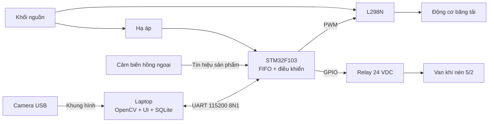
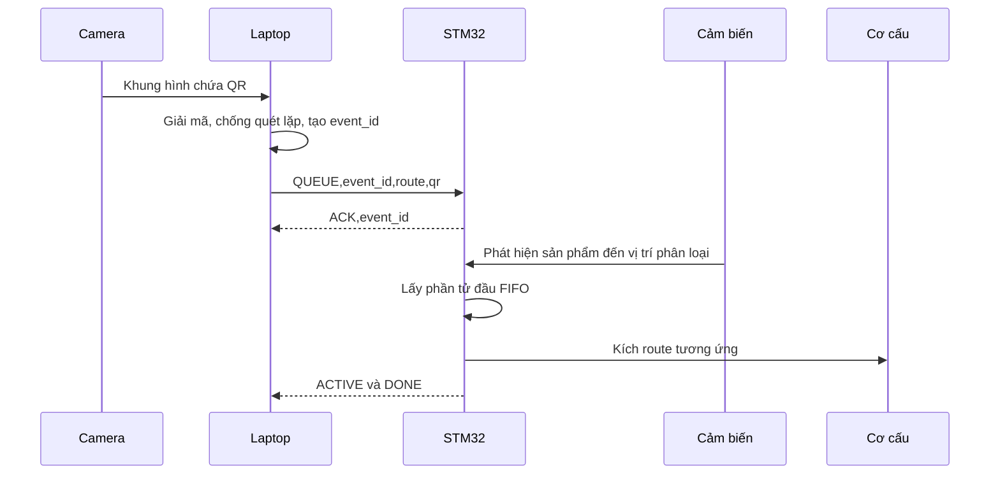

# QR Vision Studio - Phân loại sản phẩm bằng mã QR

Ứng dụng HMI chạy trên laptop dùng camera USB để đọc mã QR, quản lý thứ tự sản phẩm và giao tiếp hai chiều với STM32F103 qua UART. STM32 lưu các sự kiện trong FIFO, đọc cảm biến tại cơ cấu phân loại và điều khiển băng tải, relay hoặc van khí nén.

> Firmware trong repository là bản tham khảo cho Arduino STM32 core. Sơ đồ chân Blue Pill phải được kiểm tra và sửa theo PCB thực tế trước khi cấp nguồn cho động cơ, relay hoặc van.

## Mục lục

- [Tổng quan hệ thống](#tổng-quan-hệ-thống)
- [Chức năng chính](#chức-năng-chính)
- [Cài đặt nhanh trên Windows](#cài-đặt-nhanh-trên-windows)
- [Khởi chạy thủ công](#khởi-chạy-thủ-công)
- [Quy trình vận hành](#quy-trình-vận-hành)
- [Cấu hình nhận dạng và phân loại](#cấu-hình-nhận-dạng-và-phân-loại)
- [Giao tiếp UART](#giao-tiếp-uart)
- [Dữ liệu và nhật ký](#dữ-liệu-và-nhật-ký)
- [Cấu trúc repository](#cấu-trúc-repository)
- [Kiểm tra trước khi chạy thật](#kiểm-tra-trước-khi-chạy-thật)
- [An toàn](#an-toàn)
- [Tài liệu chi tiết](#tài-liệu-chi-tiết)

## Tổng quan hệ thống



Luồng xử lý một sản phẩm:



Camera chỉ xác định loại hàng và thứ tự. Thời điểm kích cơ cấu do STM32 quyết định theo cảm biến, không dựa vào một khoảng trễ cố định từ camera đến piston.

## Chức năng chính

### Camera và thuật toán QR

- Xem camera realtime, hiển thị FPS và số QR trong khung.
- Đọc nhiều QR bằng `detectAndDecodeMulti`.
- Tự chuyển sang `detectAndDecode` khi không có kết quả đa mã.
- Mỗi 5 frame chạy nhánh tăng cường: ảnh xám, phóng 2 lần và nhị phân Otsu.
- Vẽ polygon tại đúng vị trí QR và giữ tỷ lệ ảnh khi thay đổi kích thước cửa sổ.

### Chống quét lặp

`PassageGate` chỉ tạo một sự kiện khi QR xuất hiện ổn định đủ số frame. Mã phải biến mất khỏi camera một khoảng thời gian cấu hình thì lần xuất hiện sau mới được coi là sản phẩm mới.

Ví dụ cùng mã `ABC` đi qua ba lần:

```text
#101  ABC  P1
#102  ABC  P1
#103  ABC  P1
```

Nếu `ABC` đứng yên trước camera, hệ thống chỉ tạo một sự kiện thay vì gửi lặp theo từng frame.

### HMI và điều khiển

- Tách nút bật/tắt camera khỏi lệnh `START / STOP` dây chuyền.
- Chọn cổng COM và baud rate trực tiếp trên UI.
- Đặt PWM băng tải từ 0 đến 100%.
- Hiển thị `READY`, trạng thái chạy, cảm biến, FIFO, tốc độ, cơ cấu và heartbeat.
- Hiển thị vòng đời sự kiện: `OFFLINE`, `MCU_WAIT`, `SENT`, `ACK`, `ACTIVE`, `DONE`, `ERROR`.
- Lưu SQLite, xem lại lịch sử và xuất CSV.

## Yêu cầu

- Windows 10/11 hoặc hệ điều hành có Python và camera OpenCV tương thích.
- Python 3.10 trở lên.
- Camera USB hoặc camera tích hợp.
- Cáp USB-UART phù hợp mức logic 3,3 V của STM32F103.
- STM32F103 đã nạp firmware tương thích với [giao thức UART](MCU_PROTOCOL.md).

Thư viện Python: `opencv-python`, `customtkinter`, `Pillow` và `pyserial`.

## Cài đặt nhanh trên Windows

1. Cài Python và bật tùy chọn **Add Python to PATH**.
2. Clone repository:

   ```powershell
   git clone https://github.com/MINGKK2/classifying-goods-using-QR-codes.git
   cd classifying-goods-using-QR-codes
   ```

3. Nhấp đúp `run_qr_scanner.bat`.

Script tự tìm `py` hoặc `python`, tạo `.venv`, cài thư viện từ `requirements.txt` và mở `qr_scanner.py`. Lần đầu chạy cần Internet để tải thư viện.

## Khởi chạy thủ công

### PowerShell trên Windows

```powershell
py -m venv .venv
.\.venv\Scripts\Activate.ps1
python -m pip install --upgrade pip
python -m pip install -r requirements.txt
python qr_scanner.py
```

Nếu PowerShell chặn kích hoạt môi trường ảo, gọi Python trực tiếp:

```powershell
.\.venv\Scripts\python.exe -m pip install -r requirements.txt
.\.venv\Scripts\python.exe qr_scanner.py
```

### Linux hoặc macOS

```bash
python3 -m venv .venv
source .venv/bin/activate
python -m pip install -r requirements.txt
python qr_scanner.py
```

`run_qr_scanner.bat` chỉ dùng cho Windows. DirectShow được ưu tiên trên Windows; hệ điều hành khác dùng backend camera mặc định của OpenCV.

## Quy trình vận hành

1. Sửa chân trong `mcu_fifo_example.ino` theo bo mạch thực tế.
2. Nạp firmware cho STM32F103 và mở Serial Monitor để kiểm tra `READY`.
3. Tắt Serial Monitor để giải phóng cổng COM.
4. Mở ứng dụng, chọn camera và nhấn **Bắt đầu**.
5. Chọn cổng COM, baud `115200`, nhấn **Kết nối** và chờ MCU sẵn sàng.
6. Đặt PWM, nhấn **Gửi PWM**, sau đó nhấn **START**.
7. Đưa từng QR qua vùng quan sát và theo dõi `ACK`, FIFO, `ACTIVE`, `DONE`.
8. Nhấn **STOP** trước khi ngắt UART hoặc thoát ứng dụng.

Trình tự kiểm thử an toàn và hướng dẫn từng nút nằm trong [Hướng dẫn sử dụng](docs/USER_GUIDE.md).

## Cấu hình nhận dạng và phân loại

### Tham số chống quét lặp

Sửa `scanner_settings.json`:

```json
{
  "pass_release_seconds": 0.45,
  "stable_frames": 3
}
```

| Tham số | Ý nghĩa | Khi nào nên chỉnh |
|---|---|---|
| `stable_frames` | Số frame cần nhận dạng liên tiếp trước khi tạo sự kiện | Tăng khi ảnh nhiễu; giảm khi băng tải nhanh |
| `pass_release_seconds` | Thời gian QR phải biến mất để mở lượt mới | Giảm khi khoảng cách giữa hai kiện ngắn |

Các giá trị này được đọc khi ứng dụng khởi động. Sau khi sửa file, hãy khởi động lại chương trình.

### Ánh xạ QR sang route

Sửa `route_rules.json`:

```json
{
  "__DEFAULT__": "HOLD",
  "MA_HANG_A": "P1",
  "MA_HANG_B": "P2",
  "MA_HANG_LOI": "REJECT"
}
```

- `P1`, `P2`: kích cơ cấu tương ứng.
- `REJECT`: đưa sản phẩm sang tuyến loại.
- `HOLD`: lấy sản phẩm khỏi FIFO nhưng không kích piston.
- `__DEFAULT__`: route áp dụng cho QR chưa khai báo.

Ứng dụng tự nạp lại `route_rules.json` khi file được lưu. Nên giữ `__DEFAULT__` là `HOLD` trong quá trình thử nghiệm.

## Giao tiếp UART

Mặc định: `115200 baud`, 8 data bits, no parity, 1 stop bit. Mỗi bản tin là ASCII kết thúc bằng LF.

PC gửi:

```text
HELLO
START
STOP
SPEED,<0..100>
GET_STATUS
QUEUE,<event_id>,<route>,<qr_base64url>
```

MCU phản hồi:

```text
READY
STATE,RUNNING
SENSOR,1
FIFO,3,32
ACK,101
ACTIVE,101,P1
DONE,101
ERR,101,NO_ROUTE
HEARTBEAT,12000,RUNNING,0,2,60
```

Nội dung QR được mã hóa UTF-8 rồi chuyển sang Base64 URL-safe, bỏ dấu `=`. PC gửi tối đa 72 byte QR cho MCU; SQLite vẫn giữ nội dung đầy đủ.

Ví dụ QR `SP-A,001`:

```text
QUEUE,101,P1,U1AtQSwwMDE
```

Đặc tả đầy đủ và quy tắc FIFO nằm trong [MCU_PROTOCOL.md](MCU_PROTOCOL.md).

## Dữ liệu và nhật ký

SQLite được tạo tự động tại `qr_events.db`:

| Trường | Nội dung |
|---|---|
| `id` | `event_id` tăng dần |
| `scanned_at` | Thời gian quét ISO 8601 đến mili giây |
| `qr_content` | Nội dung QR đầy đủ |
| `route` | Tuyến phân loại |
| `mcu_status` | Trạng thái xử lý hiện tại |
| `mcu_message` | Thông báo hoặc lý do lỗi từ MCU |

Terminal xuất JSON Lines theo thứ tự:

```json
{"event_id":101,"time":"2026-10-10T14:30:01.125","qr":"ABC","route":"P1","mcu_status":"SENT"}
```

Nút **Xuất CSV** lấy toàn bộ bản ghi trong SQLite, không chỉ các dòng đang hiển thị trên giao diện.

## Cấu trúc repository

```text
.
├── qr_scanner.py             # UI, camera, QR, SQLite và UART
├── mcu_fifo_example.ino      # Firmware STM32F103 tham khảo
├── MCU_PROTOCOL.md           # Đặc tả bản tin UART
├── route_rules.json          # Ánh xạ nội dung QR sang route
├── scanner_settings.json     # Tham số PassageGate
├── requirements.txt          # Thư viện Python
├── run_qr_scanner.bat        # Trình khởi chạy tự động trên Windows
└── docs/
    ├── ARCHITECTURE.md
    ├── HARDWARE_AND_STM32.md
    ├── TROUBLESHOOTING.md
    └── USER_GUIDE.md
```

## Kiểm tra trước khi chạy thật

Kiểm tra cú pháp Python:

```powershell
python -m py_compile qr_scanner.py
```

Kiểm tra không tải:

1. Ngắt khí nén và tháo tải động cơ.
2. Thay các đầu ra piston bằng LED hoặc đồng hồ đo.
3. Kiểm tra `READY`, `STATE`, `SENSOR`, `FIFO` và `HEARTBEAT`.
4. Gửi lần lượt `START`, `SPEED,30`, `STOP`.
5. Quét một QR và xác nhận chỉ có một `event_id`.
6. Kích cảm biến bằng tay và kiểm tra đúng route được kích trong thời gian giới hạn.
7. Chỉ đấu relay, van và khí nén sau khi toàn bộ bước trên đạt.

## An toàn

- Nút `STOP` trên UI là dừng phần mềm, không thay thế E-stop vật lý.
- STM32 phải khởi động với motor, relay và piston đều tắt.
- Thử đầu ra bằng LED trước khi đấu relay hoặc van điện từ.
- Không cấp tải van trực tiếp từ GPIO STM32; dùng driver, relay phù hợp và diode dập xung.
- Đảm bảo chung mass đúng cách giữa STM32, USB-UART và driver; kiểm tra mức logic 3,3 V.
- Không tự retry `QUEUE` nếu MCU chưa có chống trùng bằng `event_id`.
- Duy trì route mặc định `HOLD` cho mã chưa cấu hình.

## Giới hạn hiện tại

- Hai lượt cùng một QR được phân biệt theo thời gian mã biến mất khỏi camera.
- Nếu nhiều kiện xuất hiện đồng thời hoặc vượt nhau trong vùng nhìn, cần thêm cảm biến trigger, ROI hoặc line-crossing.
- Giao thức dòng chưa có CRC toàn bản tin.
- Sau khi MCU reset, ứng dụng chưa tự đồng bộ snapshot FIFO.
- FPS, tỷ lệ đọc đúng và độ trễ phải được đo trên camera, máy tính và băng tải thực tế.

## Tài liệu chi tiết

- [Kiến trúc phần mềm và luồng dữ liệu](docs/ARCHITECTURE.md)
- [Hướng dẫn sử dụng từ cài đặt đến vận hành](docs/USER_GUIDE.md)
- [Đấu nối và tích hợp STM32F103](docs/HARDWARE_AND_STM32.md)
- [Xử lý sự cố](docs/TROUBLESHOOTING.md)
- [Giao thức UART PC ↔ STM32F103](MCU_PROTOCOL.md)

## Đóng góp

Khi thay đổi giao thức UART, cần cập nhật đồng thời `qr_scanner.py`, `mcu_fifo_example.ino`, `MCU_PROTOCOL.md`, README và tài liệu liên quan.

Không commit `qr_events.db`, `.venv`, file xuất CSV, thư mục `output/`, `tmp/` hoặc báo cáo DOCX/PDF sinh cục bộ.
