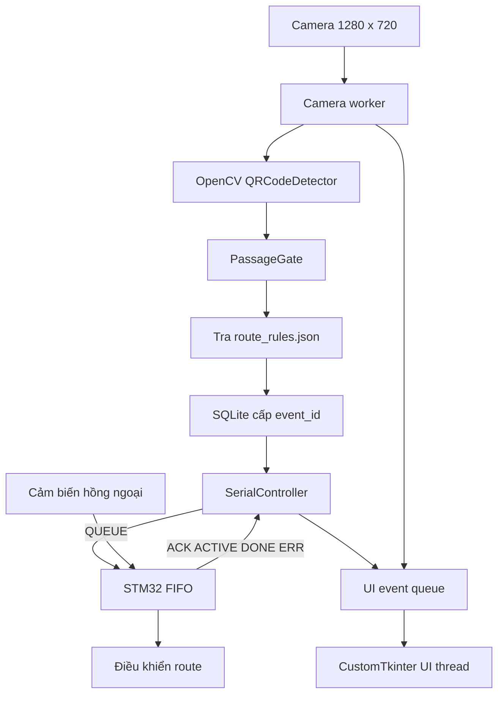
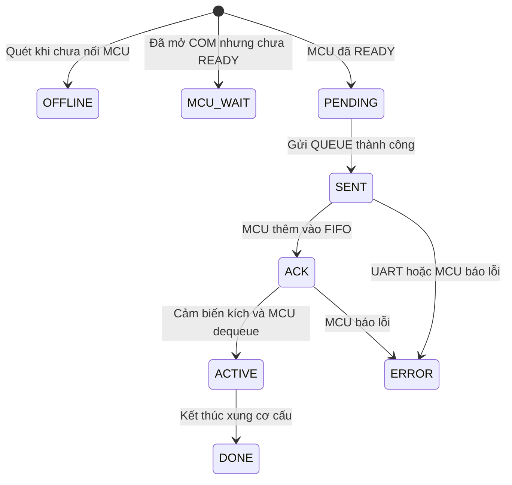

# Kiến trúc hệ thống QR Vision Studio

Tài liệu này mô tả cách các khối camera, phần mềm laptop và STM32F103 phối hợp để phân loại sản phẩm đúng thứ tự.

## 1. Phân chia trách nhiệm

| Khối | Trách nhiệm |
|---|---|
| Camera | Cung cấp khung hình vùng quét QR |
| Laptop | Nhận dạng QR, chống quét lặp, ánh xạ route, tạo `event_id`, lưu SQLite và giao tiếp UART |
| STM32F103 | Lưu FIFO, đọc cảm biến, điều khiển motor, relay, piston và gửi telemetry |
| Cảm biến | Xác nhận sản phẩm đã đến vị trí phân loại |
| Cơ cấu | Tác động theo route ở phần tử đầu FIFO |

Nguyên tắc quan trọng: laptop quyết định **sản phẩm là gì**, STM32 quyết định **khi nào tác động**.

## 2. Luồng dữ liệu



## 3. Mô hình luồng phần mềm

Ứng dụng không thực hiện camera và UART trực tiếp trong UI thread.

- `camera-worker`: đọc frame, giải mã QR và tạo sự kiện quét.
- `mcu-reader`: đọc từng dòng UART từ STM32.
- UI thread: nhận sự kiện qua `queue.Queue`, cập nhật widget và nhật ký.
- `EventStore`: mở kết nối SQLite ngắn hạn dưới khóa `threading.Lock`.

Cách tách này tránh giao diện bị treo khi camera chờ frame hoặc cổng COM chờ dữ liệu.

## 4. Thuật toán nhận dạng

Mỗi frame được xử lý theo thứ tự:

1. `detectAndDecodeMulti` để nhận nhiều mã.
2. Nếu không có kết quả, dùng `detectAndDecode` cho một mã.
3. Cứ mỗi 5 frame, chạy nhánh tăng cường:
   - chuyển ảnh sang grayscale;
   - phóng 2 lần bằng `INTER_CUBIC`;
   - nhị phân Otsu;
   - giải mã lại và quy đổi polygon về tọa độ ảnh gốc.

Nhánh tăng cường không chạy ở mọi frame để hạn chế tải CPU.

## 5. PassageGate và chống quét lặp

Mỗi nội dung QR có trạng thái riêng:

| Trường | Ý nghĩa |
|---|---|
| `hits` | Số frame liên tiếp đã nhận dạng được |
| `last_seen` | Thời điểm cuối QR còn xuất hiện, dùng `time.monotonic()` |
| `emitted` | Lượt hiện tại đã tạo sự kiện hay chưa |

Mặc định:

- tạo sự kiện khi `hits >= 3`;
- không tạo lại khi QR vẫn ở trong khung;
- xóa trạng thái sau khi QR biến mất ít nhất `0.45 s`.

Hai tham số được cấu hình trong `scanner_settings.json` và đọc lúc khởi động.

## 6. Vòng đời một sự kiện



Ứng dụng ghi bản ghi vào UI trước khi gửi UART để phản hồi `ACK` không thể đến trước dòng lịch sử tương ứng.

## 7. SQLite

Database `qr_events.db` được tạo tự động với bảng:

```sql
CREATE TABLE scan_events (
    id INTEGER PRIMARY KEY AUTOINCREMENT,
    scanned_at TEXT NOT NULL,
    qr_content TEXT NOT NULL,
    route TEXT NOT NULL,
    mcu_status TEXT NOT NULL,
    mcu_message TEXT NOT NULL DEFAULT ''
);
```

`id` chính là `event_id`. AUTOINCREMENT giúp thứ tự không bị quay lại khi ứng dụng khởi động lại.

## 8. Hàng đợi phía laptop và STM32

- Khi cổng COM đã mở nhưng MCU chưa gửi `READY`, bản ghi ở trạng thái `MCU_WAIT` và được giữ trong pending queue phía laptop.
- Khi nhận `READY`, ứng dụng flush pending queue theo thứ tự.
- Sau `ACK`, sự kiện nằm trong FIFO STM32.
- FIFO chỉ dequeue ở cạnh kích hoạt cảm biến và khi hệ thống đang `RUNNING`.
- Route `HOLD` vẫn dequeue nhưng không kích piston.

Ứng dụng không retry mù khi thiếu `ACK`. Nếu cần retry, STM32 phải dùng `event_id` làm khóa chống trùng.

## 9. Giới hạn thiết kế hiện tại

- QR được gắn với một lượt sản phẩm theo cơ chế xuất hiện/biến mất, chưa theo dõi vật thể bằng tracker.
- Nếu nhiều sản phẩm vượt nhau trong vùng camera, thứ tự hình học có thể không tương ứng thứ tự trên băng tải.
- Giao thức UART chưa có CRC và session ID.
- Chưa có cơ chế đồng bộ snapshot FIFO sau khi STM32 reset.

Hướng mở rộng phù hợp: cảm biến trigger tại vùng camera, ROI/line-crossing, CRC bản tin, lệnh `SYNC` và `CLEAR_FIFO` có xác nhận.
