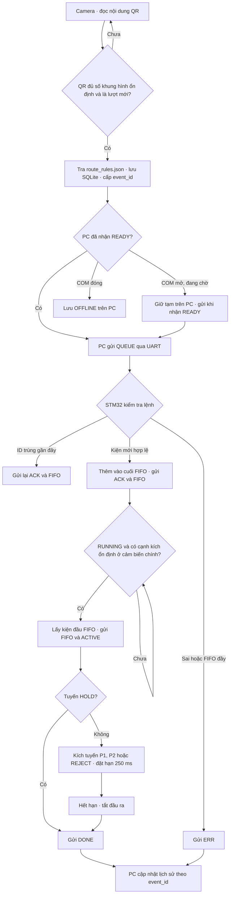

# Luồng chương trình phân loại hàng bằng QR

PC đọc QR, xác định tuyến và gửi kiện vào hàng đợi của STM32. STM32 lấy kiện đầu FIFO khi cảm biến chính phát hiện hàng, kích đầu ra tương ứng với tuyến và gửi kết quả về PC.

## Luồng từ camera đến đầu ra



- **PC.** `_camera_loop()` đọc QR, dùng bộ lọc lượt đi qua và lưu nội dung đầy đủ vào SQLite. `_route_for()` tra tuyến. `send_queue()` mã hóa tối đa 72 byte UTF-8 thành Base64 URL-safe, bỏ dấu `=`. `_handle_mcu_line()` cập nhật lịch sử khi nhận `ACK`, `DONE` hoặc `ERR`. `ACTIVE` cập nhật ô hiển thị cơ cấu.
- **STM32.** `setup()` tắt đầu ra, khởi tạo GPIO, UART và OLED, sau đó gửi `READY` và trạng thái ban đầu. Trong mỗi vòng `loop()`, chương trình lần lượt kiểm tra hạn xung, đọc nút, xử lý UART, đọc cảm biến, phát heartbeat và cập nhật OLED. `readSerialCommands()` ghép byte thành dòng rồi gọi `handleCommand()`.
- **Cảm biến.** `processSensor()` chờ tín hiệu ổn định 60 ms. Cảm biến chính là PB0 trong cấu hình Proteus và PB12 trong cấu hình PDF. PB12 là giả định cần đối chiếu với vị trí cảm biến thực tế. Kiện tiếp theo cần một cạnh kích mới.
- **Dừng.** `stopSystem()` tắt đầu ra và giữ các kiện còn chờ trong FIFO. Nếu đang kích một kiện, STM32 trả lỗi theo ID kiện đó. Nếu cảm biến kích khi đang chạy xung, STM32 dừng với `SENSOR_WHILE_BUSY`. Nếu cảm biến kích khi FIFO rỗng, STM32 báo `SENSOR_WITH_EMPTY_QUEUE` và giữ trạng thái chạy. Reset xóa FIFO.

## UART giữa PC và STM32

Mặc định **115200 baud, 8N1**. PC và STM32 trao đổi dòng ASCII kết thúc bằng LF (`\n`). Firmware cũng nhận CRLF. Đấu TX bộ USB–UART vào **PA10**, RX bộ chuyển đổi vào **PA9**, nối chung GND và dùng mức logic **3,3 V**.

### PC gửi → STM32 nhận

| Lệnh | Ví dụ | Tác dụng | Phản hồi thường gặp |
|---|---|---|---|
| `HELLO` | `HELLO` | Bắt tay khi mở cổng COM | `READY`, `STATE`, `SENSOR`, `FIFO`, `SPEED` |
| `GET_STATUS` | `GET_STATUS` | Đọc trạng thái hiện tại | `STATE`, `SENSOR`, `FIFO`, `SPEED` |
| `START` | `START` | Vào chế độ chạy nếu nút STOP đang nhả | `STATE,RUNNING`, `ACKCTRL,START` |
| `STOP` | `STOP` | Tắt đầu ra và giữ kiện đang chờ | `STATE,STOPPED`, `ACKCTRL,STOP`; có thể có `ERR` cho kiện đang kích |
| `SPEED,<pct>` | `SPEED,30` | Đặt tốc độ từ 0 đến 100%. Bản mạch PDF dùng PA11 xuất PWM | `SPEED,30`, `ACKCTRL,SPEED` |
| `QUEUE,<id>,<route>,<qr_base64url>` | `QUEUE,101,P1,U1AtQSwwMDE` | Xếp kiện vào FIFO 32 phần tử. Tuyến hợp lệ là `P1`, `P2`, `REJECT`, `HOLD` | `ACK,101` và `FIFO,1,32` nếu trước đó FIFO rỗng; `ERR` nếu bị từ chối |

### STM32 gửi → PC nhận

| Bản tin | Ví dụ | Ý nghĩa |
|---|---|---|
| `READY` | `READY` | MCU sẵn sàng. Phát lúc khởi động hoặc khi nhận `HELLO` |
| `STATE,<state>` | `STATE,RUNNING` | Trạng thái `RUNNING` hoặc `STOPPED` |
| `SENSOR,<0/1>` | `SENSOR,1` | Trạng thái đã lọc của cảm biến chính. `1` là có hàng |
| `FIFO,<count>,<capacity>` | `FIFO,0,32` | Số kiện đang chờ và dung lượng FIFO |
| `SPEED,<pct>` | `SPEED,30` | Giá trị tốc độ đã đặt |
| `ACK,<id>` | `ACK,101` | MCU đã nhận kiện. ID trùng trong cửa sổ ghi nhớ được ACK lại mà không thêm kiện |
| `ACTIVE,<id>,<route>` | `ACTIVE,101,P1` | Kiện đã được lấy khỏi FIFO và bắt đầu bước xử lý tuyến |
| `DONE,<id>` | `DONE,101` | Xung đã kết thúc. Với `HOLD`, bản tin đến ngay sau `ACTIVE` |
| `ACKCTRL,<command>` | `ACKCTRL,STOP` | Xác nhận lệnh `START`, `STOP` hoặc `SPEED` |
| `ERR,<id>,<reason>` | `ERR,101,QUEUE_FULL` | Lỗi liên quan kiện hoặc lệnh. ID `0` dùng cho lỗi không gắn với kiện cụ thể |
| `HEARTBEAT,<uptime_ms>,<state>,<sensor>,<fifo_count>,<speed>` | `HEARTBEAT,15000,RUNNING,0,1,30` | Gói trạng thái định kỳ khoảng mỗi giây |

Các lỗi thường gặp gồm `BAD_COMMAND`, `BAD_SPEED`, `BAD_QUEUE_FORMAT`, `BAD_EVENT_ID`, `NO_ROUTE`, `QUEUE_FULL`, `STOP_BUTTON_HELD`, `BAD_FRAME`, `LINE_TOO_LONG`, `SENSOR_WITH_EMPTY_QUEUE`, `SENSOR_WHILE_BUSY` và `STOPPED_DURING_ACTUATION`.

### Ví dụ một lượt phân loại

```text
PC  → STM32   HELLO
STM32 → PC    READY
STM32 → PC    STATE,STOPPED
STM32 → PC    SENSOR,0
STM32 → PC    FIFO,0,32
STM32 → PC    SPEED,60
PC  → STM32   SPEED,30
STM32 → PC    SPEED,30
STM32 → PC    ACKCTRL,SPEED
PC  → STM32   QUEUE,101,P1,U1AtQSwwMDE
STM32 → PC    ACK,101
STM32 → PC    FIFO,1,32
PC  → STM32   START
STM32 → PC    STATE,RUNNING
STM32 → PC    ACKCTRL,START
              [Cảm biến chính kích ổn định 60 ms]
STM32 → PC    SENSOR,1
STM32 → PC    FIFO,0,32
STM32 → PC    ACTIVE,101,P1
              [Hết xung 250 ms, đầu ra P1 tắt]
STM32 → PC    DONE,101
```

## Mã nguồn để đối chiếu

| Phần | Tệp và hàm |
|---|---|
| Camera, tra tuyến và lưu lịch sử | `qr_scanner.py` · `_camera_loop()`, `_route_for()` |
| Kết nối COM, gửi và nhận dữ liệu | `qr_scanner.py` · `SerialController.connect()`, `send_queue()`, `_read_loop()`, `_handle_mcu_line()` |
| Cấu hình chân và mức kích | `firmware/qr_sorter/board_config.h` |
| Phân tích UART và xếp FIFO | `firmware/qr_sorter/qr_sorter.cpp` · `readSerialCommands()`, `handleCommand()`, `handleQueueCommand()` |
| Kích đầu ra, hết hạn và dừng | `firmware/qr_sorter/qr_sorter.cpp` · `processSensor()`, `processPistonTimeout()`, `stopSystem()` |
